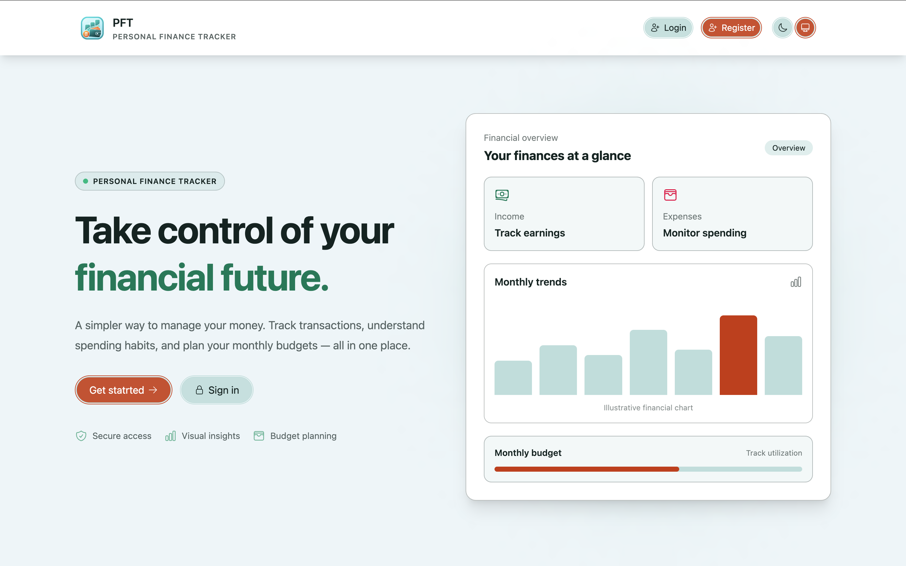
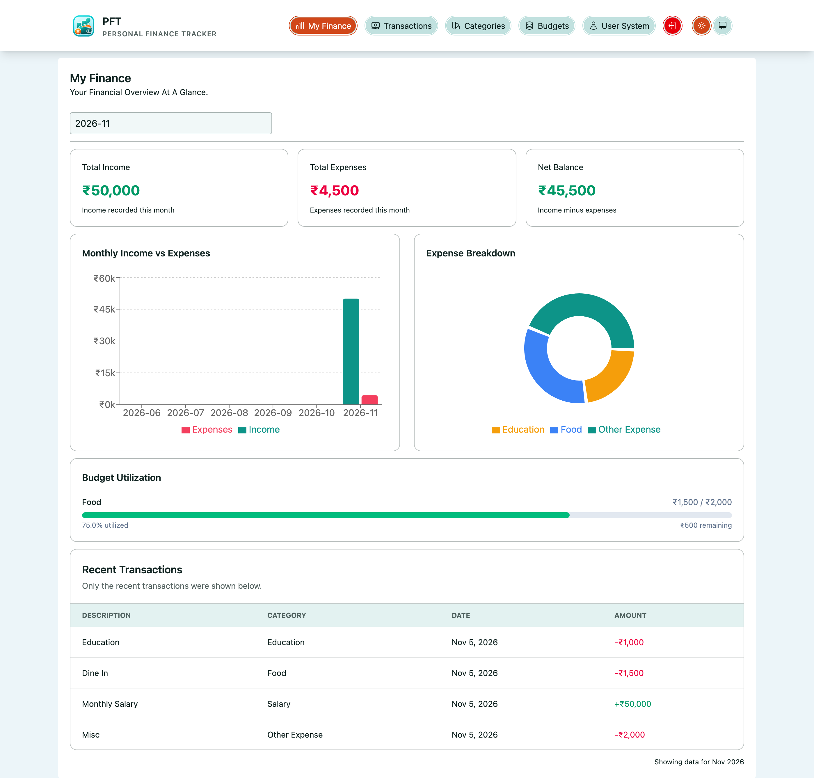
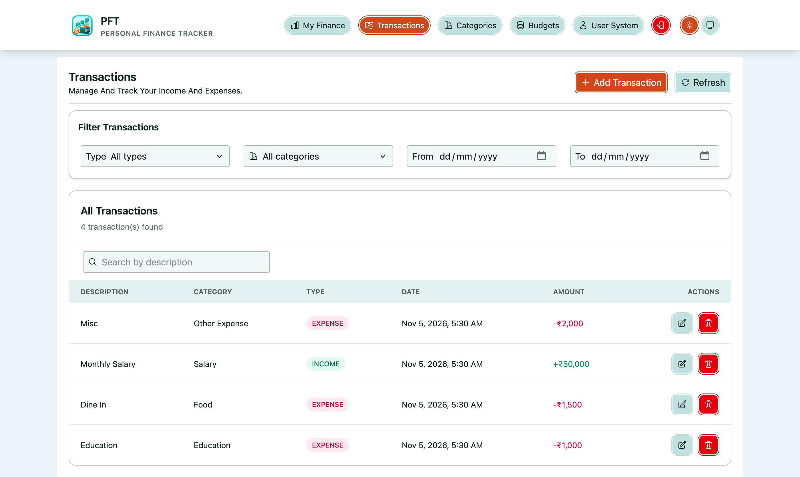
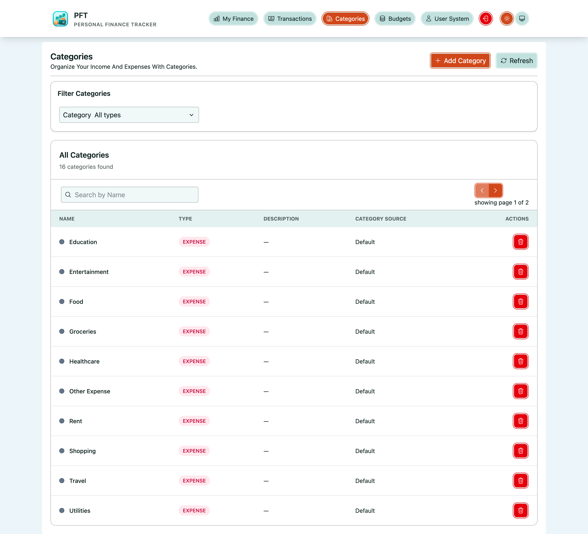
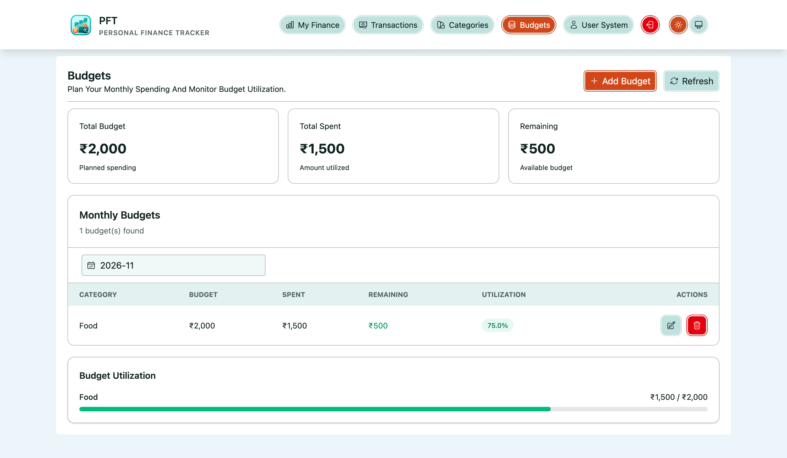

# Personal Finance Tracker


Personal Finance Tracker is a full-stack application designed to make everyday financial management simple and accessible. Built using **Java, Spring Boot, Spring Cloud, React, TypeScript, PostgreSQL, and MongoDB**, it provides a centralized place to manage income, expenses, categories, and monthly budgets.

The application combines a modular microservices backend with a clean, minimal frontend. Rather than overwhelming users with complicated financial tools, it focuses on the essentials: recording transactions, understanding spending patterns, tracking budgets, and getting a clear picture of personal finances.

---

## Contents

- [Highlights](#highlights)
- [Application architecture](#application-architecture)
- [Financial management features](#financial-management-features)
- [Dashboard and financial insights](#dashboard-and-financial-insights)
- [UI and user experience](#ui-and-user-experience)
- [Technology stack](#technology-stack)
- [Repository structure](#repository-structure)
- [Configuration](#configuration)
- [Run locally](#run-locally)
- [Build and quality checks](#build-and-quality-checks)
- [API overview](#api-overview)
- [Security and observability](#security-and-observability)
- [Author](#author)

---

## Highlights

- **Personalized financial dashboard:** View monthly income, expenses, net balance, spending distribution, and financial trends.
- **Transaction management:** Create, view, update, delete, and filter income and expense transactions.
- **Category management:** Organize transactions using predefined and custom categories.
- **Monthly budgeting:** Set category-wise budgets and monitor spending against allocated amounts.
- **Budget utilization:** Track budget consumption, remaining amounts, and utilization percentages.
- **Visual financial insights:** Understand spending patterns through interactive charts and financial summaries.
- **Secure authentication:** JWT-based authentication with protected application routes and APIs.
- **User data isolation:** Financial records are associated with the authenticated user.
- **Simple and responsive UI:** A straightforward navigation structure, focused screens, reusable components, and minimal interaction complexity.
- **Reusable backend platform:** Shared logging, security, REST-client, and web infrastructure.
- **Microservices architecture:** Independent identity and finance services supported by API Gateway, Eureka, and centralized configuration.

---

# Application architecture

Personal Finance Tracker follows a **Maven multi-module monorepo architecture**. The application separates identity management from financial operations while sharing common backend infrastructure through reusable platform modules.

The React frontend communicates with backend services through the API Gateway. The Identity Service manages authentication and user information, while the Finance Service handles transactions, categories, budgets, and dashboard calculations.

PostgreSQL is used for identity and relational user data, while MongoDB stores financial domain data.

### High-level architecture

```text
┌───────────────────────────────────────────────────────────────┐
│                         React Web UI                          │
│                                                               │
│  Landing │ Dashboard │ Transactions │ Categories │ Budgets    │
│                         Profile                               │
└───────────────────────────────┬───────────────────────────────┘
                                │ HTTP + JWT
                                ▼
┌───────────────────────────────────────────────────────────────┐
│                    API Gateway :9090                          │
│                  Spring Cloud Gateway                         │
└───────────────────────────────┬───────────────────────────────┘
                                │
                    ┌───────────┴────────────┐
                    │                        │
             /identity/**              /finance/**
                    │                        │
                    ▼                        ▼
       ┌─────────────────────┐  ┌──────────────────────────────┐
       │  Identity Service   │  │       Finance Service        │
       │                     │  │                              │
       │  Authentication     │  │  Transactions                │
       │  User Management    │  │  Categories                  │
       │  JWT / Refresh      │  │  Budgets                     │
       │  Token Management   │  │  Dashboard & Aggregations    │
       └──────────┬──────────┘  └──────────────┬───────────────┘
                  │                            │
                  ▼                            ▼
       ┌─────────────────────┐  ┌──────────────────────────────┐
       │    PostgreSQL       │  │           MongoDB            │
       │                     │  │                              │
       │ financetracker_     │  │ financetracker               │
       │ identity            │  │                              │
       └─────────────────────┘  └──────────────────────────────┘


┌───────────────────────────────────────────────────────────────┐
│                  Spring Cloud Infrastructure                  │
│                                                               │
│  Config Server :8888       Eureka Server :8761                │
└───────────────────────────────────────────────────────────────┘


┌───────────────────────────────────────────────────────────────┐
│                     Shared Platform                           │
│                                                               │
│       Logging │ Security │ REST Client │ Web                  │
└───────────────────────────────────────────────────────────────┘
```

### Backend service boundaries

| Service / Module | Responsibility | Local port / entry point |
|---|---|---|
| API Gateway | Routes incoming API requests to registered backend services | `9090` |
| Identity Service | Registration, authentication, JWT, refresh tokens, and user management | `8080` (default Spring Boot port) |
| Finance Service | Transactions, categories, budgets, and dashboard calculations | `8081` |
| Config Server | Externalized application configuration | `8888` |
| Eureka Server | Service registration and discovery | `8761` |
| PostgreSQL | Identity and user data persistence | `5432` |
| MongoDB | Financial data persistence | `27017` |

### Request flow

```text
                        React Application
                               │
                               │ HTTP + Bearer Token
                               ▼
                         API Gateway
                               │
                 ┌─────────────┴──────────────┐
                 │                            │
                 ▼                            ▼
          Identity Service              Finance Service
                 │                            │
                 ▼                            ▼
             PostgreSQL                    MongoDB
                 │                            │
                 ▼                            ▼
          User / Identity                Financial Data
```

The API Gateway uses Spring Cloud Gateway's WebMVC implementation. Services register with Eureka and retrieve their externalized configuration through the Config Server.

### Shared platform modules

The application uses a reusable platform layer to avoid duplicating common infrastructure across backend services.

| Module | Responsibility |
|---|---|
| `platform/logging` | Request logging, correlation IDs, exception logging, and logging configuration |
| `platform/security` | Shared JWT security infrastructure, authentication context, user abstraction, and authorization support |
| `platform/restclient` | Shared HTTP-client configuration and propagation of request context and bearer tokens |
| `platform/web` | Common web infrastructure, error definitions, validation responses, and exception handling |

This separation keeps business services focused on their respective responsibilities while allowing common infrastructure to evolve independently.

---

# Financial management features

## 1. Transaction management

The transaction module provides the core functionality for recording and maintaining financial activity.

Supported operations:

- Create income and expense transactions.
- Update existing transactions.
- Delete transactions.
- View transaction history.
- Filter transactions by:
  - Transaction type (income or expense).
  - Category.
  - Date range.
- Associate transactions with categories.
- Store descriptions, transaction dates, and optional notes.

Transactions use `BigDecimal` for monetary values to maintain appropriate financial precision.

## 2. Category management

Categories help organize transactions into meaningful financial groups.

Features include:

- Predefined default categories.
- Custom category creation.
- Income and expense category types.
- Category descriptions, colors, and icons.
- Filter categories by transaction type.
- Delete custom categories.
- Protect predefined default categories from deletion.

Default categories are initialized automatically when the Finance Service starts, without creating duplicates when they already exist.

## 3. Monthly budget management

The budget module allows users to allocate spending limits to expense categories.

Features include:

- Create monthly budgets.
- Update existing budgets.
- Delete budgets.
- View budgets for a selected month.
- Associate budgets with expense categories.
- Track actual spending against allocated amounts.
- Calculate remaining budget and utilization percentage.

Budget utilization is calculated using actual transaction data, helping users understand how much of their allocated budget has been consumed.

---

# Dashboard and financial insights

The dashboard provides a consolidated overview of the user's financial activity.

### Financial summary

The dashboard presents three primary financial indicators:

- **Total Income:** Income recorded during the selected month.
- **Total Expenses:** Expenses recorded during the selected month.
- **Net Balance:** Difference between total income and expenses.

### Visual insights

The dashboard uses Recharts to present financial information through visual summaries.

- Category-wise expense distribution.
- Monthly income and expense trends.
- Financial summary cards.
- Recent transactions.
- Budget utilization information.

### Monthly analysis

Users can select a month to view the corresponding financial information.

The backend calculates dashboard information using MongoDB aggregation pipelines and transaction queries, keeping the frontend focused on displaying the results rather than implementing financial calculations.

### Budget insights

The dashboard also provides budget utilization information, including:

- Allocated budget.
- Actual spending.
- Remaining amount.
- Utilization percentage.

---

# UI and user experience

The frontend follows a deliberately simple design philosophy: **make financial information easy to understand and everyday actions easy to perform.**

Instead of introducing complicated navigation or unnecessary interactions, the application uses a small number of focused screens with consistent layouts and reusable UI components.

### Design principles

- **Simple navigation:** Clearly organized sections for dashboard, transactions, categories, budgets, and profile.
- **Information-first dashboard:** Important financial figures are visible immediately.
- **Focused interactions:** Forms and dialogs are used for creating and updating financial records.
- **Consistent components:** Shared tables, buttons, inputs, notifications, modals, and layout components.
- **Responsive layout:** Tailwind CSS supports different screen sizes.
- **Theme-aware styling:** Shared design tokens and light/dark styling conventions maintain visual consistency.
- **Clear feedback:** Success, warning, and error notifications communicate the result of user actions.

### Application screens

| Screen | Route | Purpose |
|---|---|---|
| Landing | `/` | Public application entry point |
| Dashboard | `/dashboard` | Financial summary, charts, recent activity, and budget insights |
| Transactions | `/transactions` | Manage and filter income and expenses |
| Categories | `/categories` | Manage income and expense categories |
| Budgets | `/budgets` | Create and monitor monthly budgets |
| Profile | `/profile` | Manage user profile information |

### Screenshots

### 1. Landing and authentication

The public landing page provides an entry point to the application and its authentication workflow.

### 2. Financial dashboard

A consolidated view of monthly financial performance, category expenses, trends, and budget utilization.

### 3. Transaction management

A focused interface for recording, editing, filtering, and reviewing financial transactions.

### 4. Category management

A simple interface for organizing transactions through predefined and custom categories.

### 5. Budget management

A monthly overview of allocated budgets, actual spending, remaining amounts, and utilization.

---

# Technology stack

### Backend

- Java 25
- Spring Boot 4.1.2
- Spring Security
- Spring Data JPA / Hibernate
- Spring Data MongoDB
- Spring Cloud 2025.1.3
- Spring Cloud Config Server
- Spring Cloud Gateway (WebMVC)
- Netflix Eureka
- JWT / JJWT
- Springdoc OpenAPI
- Maven multi-module build

### Frontend

- React 19
- TypeScript
- Vite 8
- Tailwind CSS 4
- React Router 7
- Axios
- Recharts
- Heroicons

### Databases and infrastructure

- PostgreSQL
- MongoDB
- Docker Compose
- Spring Cloud Config
- Netflix Eureka

---

# Repository structure

```text
Financetracker/
│
├── platform/
│   ├── logging/
│   ├── security/
│   ├── restclient/
│   └── web/
│
├── cloud/
│   ├── apigateway/
│   ├── configserver/
│   ├── eurekaserver/
│   └── repo/
│
├── services/
│   ├── identity/
│   └── finance/
│
├── ui/
│   ├── src/
│   │   ├── api/
│   │   ├── components/
│   │   ├── config/
│   │   ├── context/
│   │   ├── layouts/
│   │   ├── pages/
│   │   ├── routes/
│   │   ├── services/
│   │   ├── storage/
│   │   ├── types/
│   │   └── utils/
│   ├── public/
│   └── package.json
│
├── docker/
│   └── postgres/
│
├── .env
├── pom.xml
└── README.md
```

### Module responsibilities

- `platform/` contains reusable backend infrastructure and cross-cutting concerns.
- `cloud/` contains the API Gateway, Config Server, Eureka Server, and externalized configuration.
- `services/` contains identity and finance business services.
- `ui/` contains the React frontend, shared components, pages, contexts, and API service integrations.
- `docker/` contains database-related Docker configuration.

---

# Configuration

The backend uses Spring Cloud Config Server to load shared and service-specific application configuration from `cloud/repo/`.

Sensitive configuration values are supplied through environment variables rather than being hardcoded into application configuration.

### Environment variables

Create a `.env` file at the repository root.

```dotenv
# PostgreSQL
DATABASE_HOST=localhost
DATABASE_PORT=5432
DATABASE_USERNAME=<database-username>
DATABASE_PASSWORD=<database-password>

# MongoDB
MONGODB_HOST=localhost
MONGODB_PORT=27017

# JWT
PLATFORM_JWT_SECRET=<strong-secret-at-least-256-bits>
```

The configured databases are:

| Database | Purpose |
|---|---|
| `financetracker_identity` | Identity and user information |
| `financetracker` | Financial transactions, categories, and budgets |

The frontend uses the API Gateway as its backend entry point.

Configure `ui/.env`:

```dotenv
VITE_API_BASE_URL=http://localhost:9090
```

---

# Run locally

## Prerequisites

- JDK 25
- Maven
- Node.js and npm
- PostgreSQL
- MongoDB
- Git

## 1. Prepare databases

Start PostgreSQL and MongoDB.

Create the identity database:

```sql
CREATE DATABASE financetracker_identity;
```

The Finance Service uses the `financetracker` MongoDB database, which is selected through its connection URI.

The repository includes a PostgreSQL Docker Compose configuration under `docker/postgres/`.

## 2. Start Eureka Server

From the repository root:

```bash
cd cloud/eurekaserver
mvn spring-boot:run
```

Eureka dashboard:

`http://localhost:8761`

## 3. Start Config Server

In a separate terminal:

```bash
cd cloud/configserver
mvn spring-boot:run
```

Config Server:

`http://localhost:8888`

## 4. Start API Gateway

In a separate terminal:

```bash
cd cloud/apigateway
mvn spring-boot:run
```

API Gateway:

`http://localhost:9090`

## 5. Start Identity Service

In a separate terminal:

```bash
cd services/identity
mvn spring-boot:run
```

The Identity Service uses PostgreSQL and registers with Eureka.

## 6. Start Finance Service

In a separate terminal:

```bash
cd services/finance
mvn spring-boot:run
```

The Finance Service uses MongoDB and registers with Eureka.

## 7. Start frontend

In a separate terminal:

```bash
cd ui
npm install
npm run dev
```

Open the URL provided by Vite, commonly:

`http://localhost:5173`

> The services depend on valid database configuration, a configured JWT secret, and a running Config Server and Eureka Server. Ensure the infrastructure services are healthy before starting the business services.

---

# Build and quality checks

### Backend

Build all Maven modules from the repository root:

```bash
./mvnw clean verify
```

Run the backend tests:

```bash
./mvnw test
```

### Frontend

Install dependencies:

```bash
cd ui
npm install
```

Run the production build:

```bash
npm run build
```

Run ESLint:

```bash
npm run lint
```

---

# API overview

The API Gateway exposes the following service prefixes:

| Prefix | Service |
|---|---|
| `/identity/**` | Identity Service |
| `/finance/**` | Finance Service |

### Identity APIs

Base path:

`/identity/api/v1`

| Endpoint | Method | Purpose |
|---|---|---|
| `/auth/` | POST | Authenticate user |
| `/auth/refresh` | POST | Refresh access token |
| `/auth/logout` | POST | Logout |
| `/users/register` | POST | Register user |
| `/users/me` | GET | Retrieve current user profile |

### Finance APIs

Base path:

`/finance/api/v1`

| Endpoint | Method | Purpose |
|---|---|---|
| `/transactions` | GET | Retrieve transactions with optional filters |
| `/transactions/{transactionId}` | GET | Retrieve a transaction |
| `/transactions` | POST | Create a transaction |
| `/transactions/{transactionId}` | PUT | Update a transaction |
| `/transactions/{transactionId}` | DELETE | Delete a transaction |
| `/categories` | GET | Retrieve categories, optionally filtered by type |
| `/categories` | POST | Create a custom category |
| `/categories/{categoryId}` | DELETE | Delete a custom category |
| `/budgets?month=YYYY-MM` | GET | Retrieve budgets for a month |
| `/budgets` | POST | Create a budget |
| `/budgets/{budgetId}` | PUT | Update a budget |
| `/budgets/{budgetId}` | DELETE | Delete a budget |
| `/dashboard?month=YYYY-MM` | GET | Retrieve monthly dashboard information |

All finance APIs require authentication. Financial ownership is derived from the authenticated user context rather than trusting a user ID supplied by the frontend.

For complete request and response schemas, refer to the corresponding controller DTOs and OpenAPI configuration.

---

# Security and observability

### Security

- JWT bearer authentication for protected APIs.
- Access and refresh token management.
- Protected frontend routes.
- Centralized security configuration through the shared platform module.
- Authenticated user context for financial operations.
- User-specific financial data isolation.
- Configurable CORS policies.

### Observability

- Centralized request logging.
- Correlation ID generation and propagation.
- Shared exception logging.
- Configurable log levels and rolling log files.
- Spring Boot Actuator health endpoints.
- Shared downstream HTTP-client configuration.
- Request context and bearer-token propagation for service communication.

---

# Author

**Venkata Kiran J**

Connect with me on [LinkedIn](https://www.linkedin.com/in/venkata-kiran-jakkapu-a2209415a/).

GitHub: [vkiranjakkapu](https://github.com/vkiranjakkapu)

---

## License

This project is a personal software engineering project.